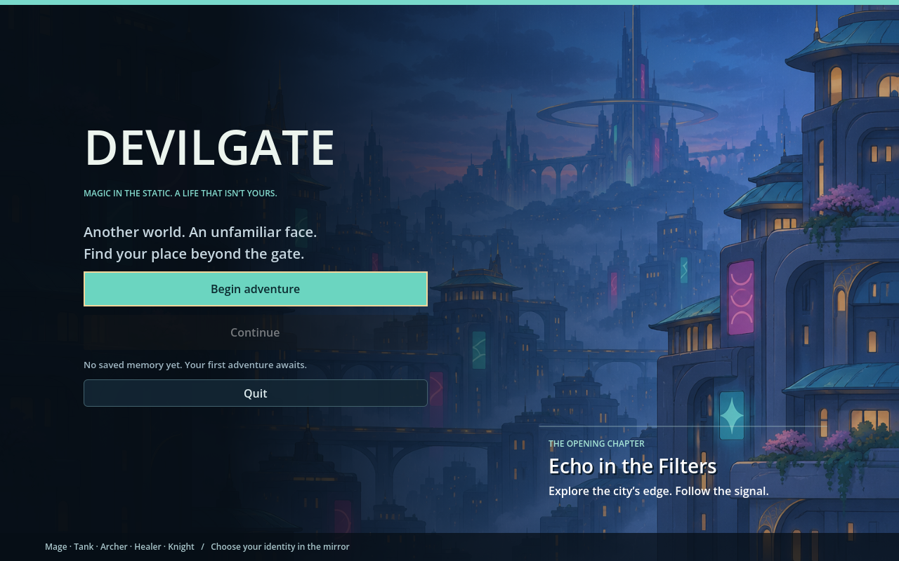
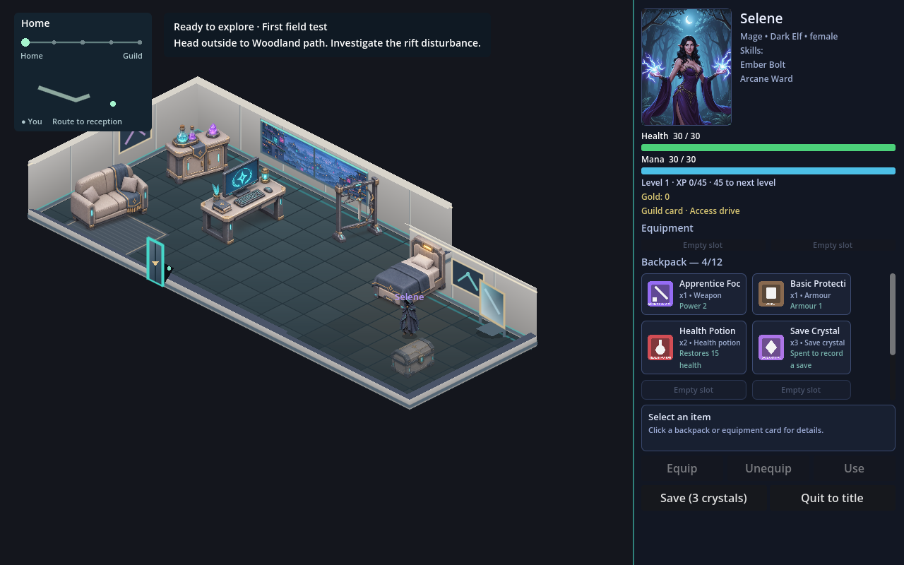
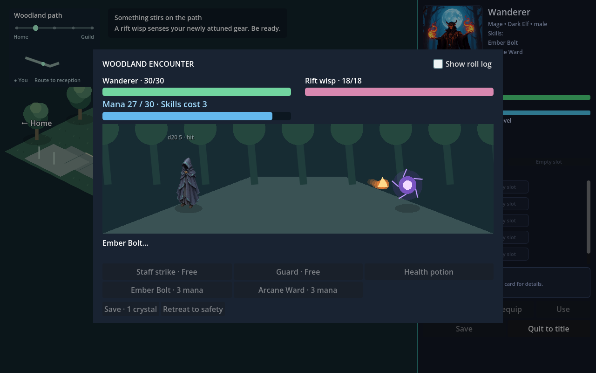
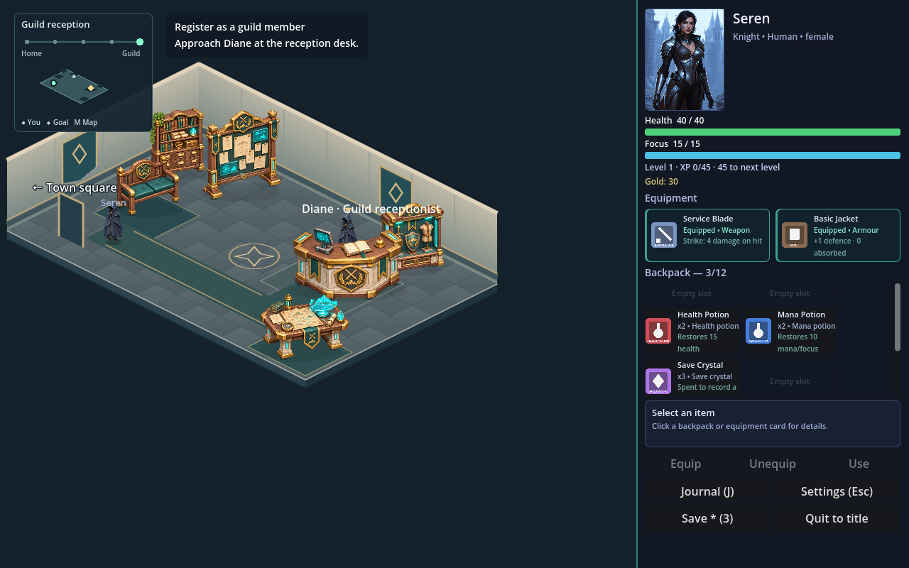
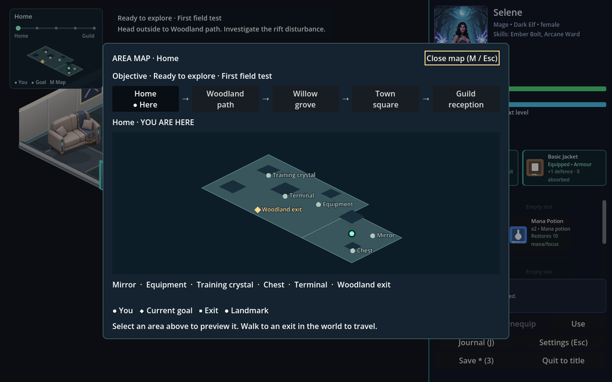

# DevilGate

Inside the Adventurers’ Guild

## The 7% project

I have lots of projects on the go, and I use AI to help with a lot of them.
Sometimes I reach a point where I have, say, 7% left before a reset. This
project is all about that 7%.

Anything left that I would normally write off, I will now use on this project.
It will be a long time in development, but the idea is to get AI to write a
full game with tokens I would otherwise have wasted. I will make small changes
myself as well, so it will not be entirely AI-built.

I will not buy extra credit just to squeeze out a bit more. It stops at the
cut-off, and development carries on when there are leftover tokens again.

When I was younger, I played far too much Shadowrun and fantasy RPGs. These
days, I keep imagining waking up in another world—a neon-lit cyberpunk
universe where magic is real.

Images and other game artwork are something I will create locally using
FLUX.2 9B. I will come up with the ideas, and may flesh them out with
Qwen3.8:27B locally. The rest comes from those small amounts of leftover
tokens—ChatGPT, Claude, or whichever service offers the best deal at the time.

I use the latest versions of Godot with C# support and Visual Studio Code
as my IDE.

## The game so far

DevilGate is a single-player isometric RPG set in a future where magic and
technology coexist, the outside air is contaminated, and protective cloaks
are a normal part of life. You wake in an unfamiliar body, in an unfamiliar
apartment, with fragments of another world's memories.

The playable prototype includes:

- Character identity and stats discovered through the apartment's mirror and equipment rack.
- Male and female Dark Elf mages, Orc tanks, Elf archers and High Human healers, plus a female Human knight, with class-specific skills and guild records. The male knight will follow later.
- Click-to-move exploration, including holding the mouse button to keep walking.
- Equipment, inventory, potions and manual saves that consume save crystals.
- A short route from home through Woodland path and Willow grove to town and the guild.
- Visual turn-based battles with health and mana/focus bars, dice rolls and XP-based levels.
- Guild registration with Diane, followed by **Echo in the Filters**, a playable investigation with a corrupted relay guardian and an Ashfall mystery.

This is an early prototype. The story currently ends after Echo in the Filters;
there is plenty left to build and polish.

## Run it

The current project uses **Godot 4.7.2 .NET**, **C#** and **.NET 10**. Development
and testing currently target macOS; other platforms have not been verified.

1. Install Godot with .NET support and the .NET 10 SDK.
2. Clone this repository.
3. Open `project.godot` in Godot.
4. Build the C# project and press Play.

You can also run `dotnet build` from the project folder, then launch the
project with your Godot .NET executable.

## Controls and comfort

Click to walk or approach an object; hold the mouse button to keep walking.
Double-click a backpack item to equip/use it, or Shift-click in the chest to
move a whole stack. **J** opens the journal. **M** or clicking the minimap opens
the area map, with the five-area route, landmarks and your current objective.
**Escape** closes an ordinary
panel first, then opens settings; active encounters must be finished or
retreated from using their controls.

Settings include saved audio levels, text size, faster battle presentation,
and reduced motion/flashes. Saving still spends one carried crystal; an
asterisk by Save indicates unsaved progress. Continue shows the saved
character and objective.

## Contributing

If you would like to help, issues and pull requests are welcome. Small fixes,
improvements and ideas are all useful. For larger changes, please open an
issue first so we can discuss how they fit the game.

I will keep working on this over time, making changes myself and developing
it with AI assistance whenever there are leftover tokens available. There is
no fixed release schedule.

Local planning documents and development review files are excluded from this
repository. The game source, required assets and these screenshots are included.
